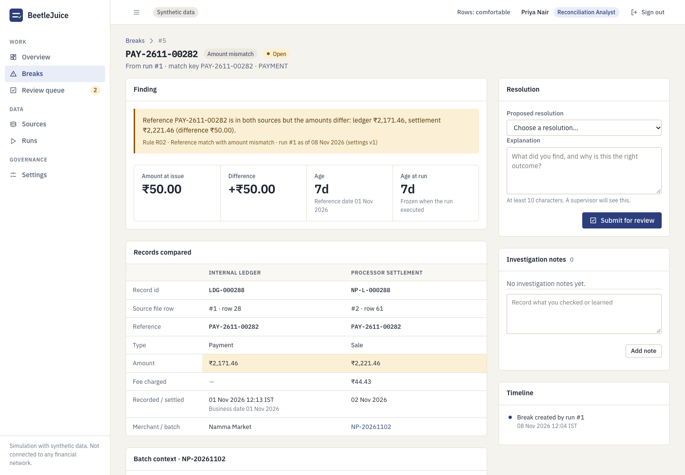
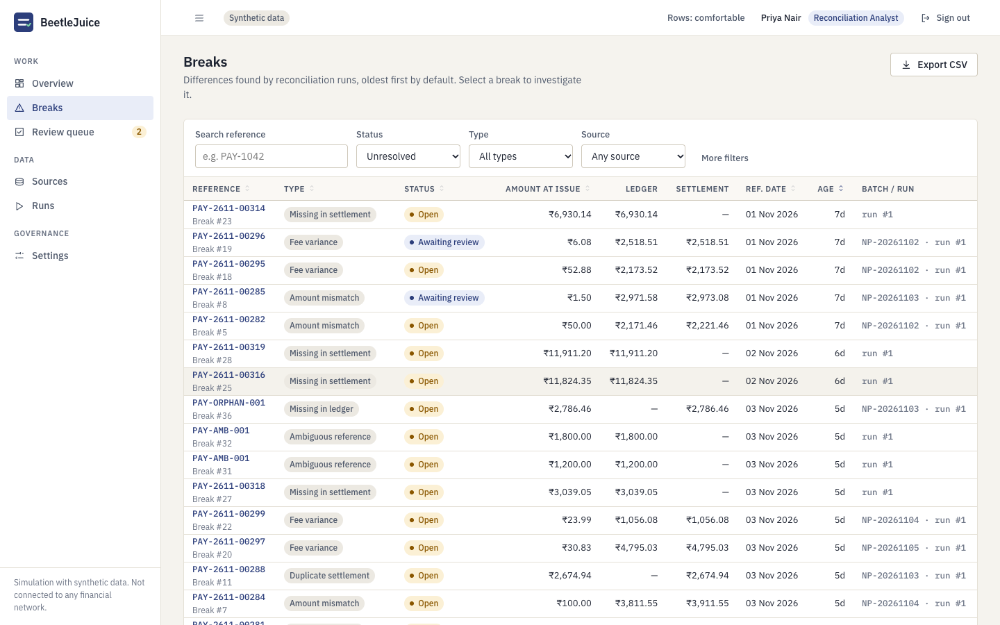
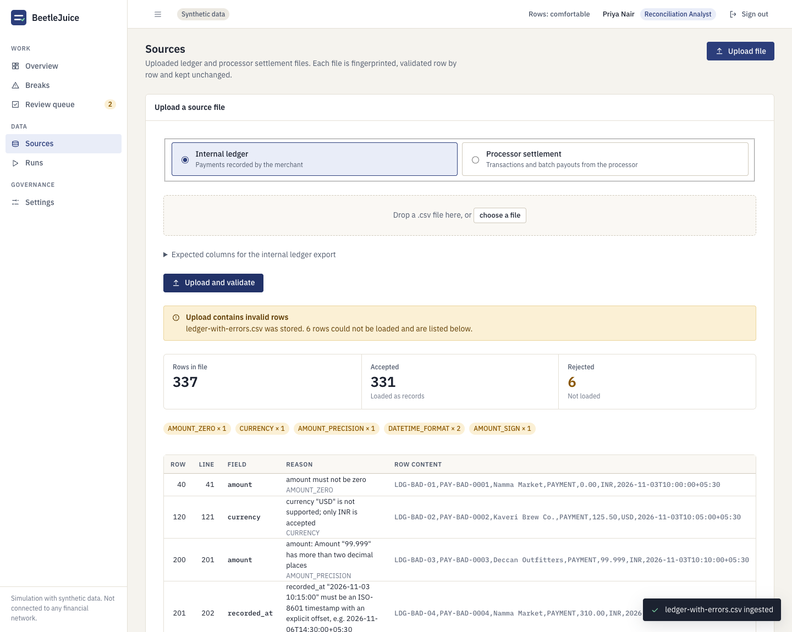
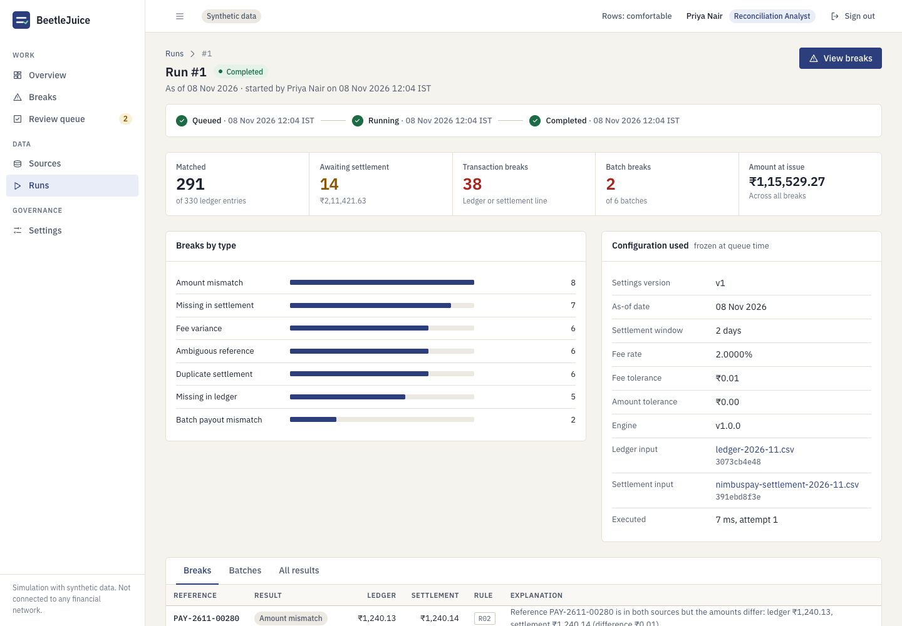
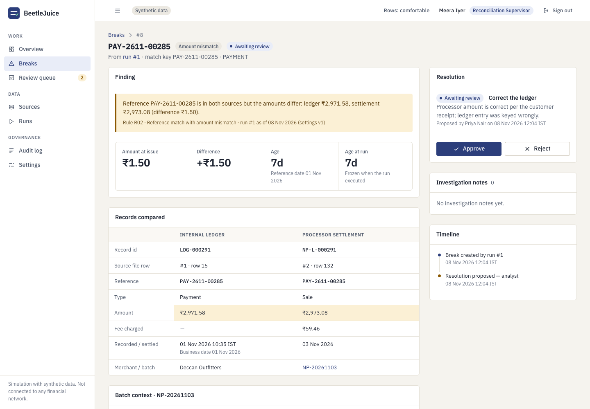

# BeetleJuice

**Settlement reconciliation and break management for payment operations.**

A merchant records payments internally. Its payment processor separately reports what it settled, with fees
and net payouts. The two rarely agree: timing, duplicates, wrong amounts, missing refunds, fee drift, short payouts.
BeetleJuice compares an internal ledger export with a processor settlement export, explains every difference,
and puts the exceptions through a controlled maker-checker resolution workflow with an audit trail.

> This is a simulation that uses **synthetic data only**. It does not connect to any bank, card network or
> payment processor, and it never posts anything to a ledger.



<table>
<tr>
<td width="50%"></td>
<td width="50%"></td>
</tr>
<tr>
<td></td>
<td></td>
</tr>
</table>

## What it does

* **Ingests two CSV exports** with strict validation: header contract, UTF-8, size and row limits, integer-paise
  amounts, explicit UTC offsets on timestamps. Invalid rows are reported (row, field, reason, original content),
  never silently dropped. Identical files are rejected by SHA-256 and a database unique index.
* **Reconciles deterministically** with a documented multi-pass engine: exact match, amount mismatch,
  duplicate settlement, pending within the settlement window, missing on either side, batch payout totals, fee
  variance — plus an **ambiguity guard** so a repeated reference is never paired by guesswork.
  Every record gets exactly one explained outcome. See [reconciliation rules](docs/reconciliation-rules.md).
* **Freezes each run's configuration** (settings version, as-of date, input hashes, engine version), so later
  settings changes never rewrite history.
* **Runs in the background** from a PostgreSQL-backed queue with leases, retries and crash recovery; the UI shows
  queued → running → completed/failed live.
* **Manages breaks**: filterable, sortable, exportable queue with ageing; detail page with both source records,
  rule, explanation, batch context, notes and timeline.
* **Enforces maker-checker**: analysts propose, a *different* supervisor approves or rejects. Concurrent decisions,
  stale views and self-approval are all refused — in the service and again in the database.
* **Keeps an append-only audit history** written in the same transaction as each change.
* **Three roles** (analyst, supervisor, read-only auditor) enforced on the server.

## Quick start

Requirements: Node.js ≥ 20.12 and a local PostgreSQL ≥ 14.

```bash
git clone https://github.com/Ayush-o1/BeetleJuice.git && cd BeetleJuice
npm install
cp .env.example .env                 # adjust DATABASE_URL if your Postgres needs credentials
npm run db:create                    # creates the database named in DATABASE_URL (never drops anything)
npm run migrate
ALLOW_DEMO_RESET=true npm run demo:reset -- --yes --load-sample   # dev only: demo users + sample run
npm run dev                          # http://localhost:3000
```

Sign in with the demo accounts (development only; password `BeetleJuice-Demo-2026`):
`analyst`, `analyst2`, `supervisor`, `supervisor2`, `auditor`.
`demo:reset` **drops the schema** of the target database and refuses to run in production, without
`ALLOW_DEMO_RESET=true`, without `--yes`, or against a database not named `*_dev`, `*_demo` or `*_test`.
For a real deployment create users with `BJ_PASSWORD=… npm run user:create -- <username> <role> "<Name>"`.

Step-by-step demonstration: [docs/demo-guide.md](docs/demo-guide.md). Sample files and their expected outcomes:
[demo-data/](demo-data/expected-outcomes.md).

## Configuration

Read and validated at start-up ([`src/config`](src/config/index.js)); the app refuses to start on invalid values.

| Variable | Default | Purpose |
|---|---|---|
| `DATABASE_URL` | — (required) | PostgreSQL connection string |
| `PORT`, `NODE_ENV`, `LOG_LEVEL` | 3000, development, info | |
| `UPLOAD_DIR` | `./data/uploads` | Where raw CSV bytes are kept (outside `public/`) |
| `MAX_UPLOAD_BYTES`, `MAX_UPLOAD_ROWS` | 10 MiB, 50,000 | Upload limits |
| `SESSION_IDLE_MINUTES`, `SESSION_ABSOLUTE_HOURS` | 30, 8 | Session lifetime |
| `COOKIE_SECURE`, `TRUST_PROXY` | true in production, false | Secure cookies; trust `X-Forwarded-*` |
| `WORKER_IN_PROCESS`, `WORKER_POLL_MS` | true, 1500 | Run the worker inside the web process |
| `RUN_MAX_ATTEMPTS`, `RUN_LEASE_SECONDS` | 3, 120 | Retry limit and lease length |
| `LOGIN_RATE_MAX`, `LOGIN_RATE_WINDOW_MINUTES` | 20, 15 | Per-IP sign-in limiter |
| `SCRYPT_LOG2_N` | 17 | Password hashing cost (≥ 17 enforced in production) |
| `ALLOW_DEMO_RESET` | false | Opt-in for `demo:reset` |

## Commands

| | |
|---|---|
| `npm run dev` / `npm start` | Start the app (`dev` restarts on change) |
| `npm run worker` | Stand-alone worker (use with `WORKER_IN_PROCESS=false`) |
| `npm run migrate` | Apply pending SQL migrations (checksummed, forward-only) |
| `npm run demo:generate` | Regenerate `demo-data/` (deterministic) |
| `npm run bench` | Measure ingest, engine and queries on 45k-row files |
| `npm test`, `test:unit`, `test:integration`, `test:e2e`, `lint` | See [docs/testing.md](docs/testing.md) |

## Architecture in brief

One Express monolith, plain SQL on PostgreSQL, a vanilla-JS single-page UI served from the same origin.

```
routes ─► services ─► repositories (SQL) ─► PostgreSQL
              │
              └─► engine (pure function)       worker: claims runs with SKIP LOCKED + lease
```

Details: [architecture](docs/architecture.md) · [domain model](docs/domain-model.md) ·
[rules](docs/reconciliation-rules.md) · [API](docs/api.md) · [security review](docs/security.md) ·
[performance](docs/performance.md) · [decision records](docs/decisions/).

Stack: Node.js, Express 5, `pg`, zod, helmet, pino, csv-parse. No ORM, no front-end framework, no build step, no Redis.

## Key design decisions

* **Integer paise everywhere; fees as exact rationals** with one documented half-up rounding rule.
* **Reference is not a unique key.** Records match on `(reference, direction)` and ambiguous groups become breaks.
* **Pending ≠ missing.** A settlement window and an explicit as-of date decide; results are immutable and a later run re-evaluates.
* **Database-enforced invariants:** one result per record per run, duplicate-file and duplicate-run protection,
  single pending/approved proposal per break, maker-checker and status-transition triggers, append-only history.
* **Server-side sessions + CSRF token**, scrypt passwords, strict CSP, permission matrix enforced per route.

## Testing

98+ automated tests: unit (engine rules, money, dates, parsers, permissions), integration against real PostgreSQL
(including concurrent uploads, runs and reviewer decisions, worker crash recovery, and constraints with the service
layer bypassed) and Chrome end-to-end journeys across all three roles. Run `npm test`; exact current totals are in
the release notes. The demo files are checked against a ground truth the generator constructs.

## Limitations (stated plainly)

* Simulation only: resolutions record a decision; nothing is posted anywhere.
* One ledger file and one settlement file per run; no merchant-specific fee rates; calendar days, no holiday calendar.
* No fuzzy matching: a mistyped reference becomes two breaks. Breaks are not carried across runs.
* The audit log is append-only by application and trigger, **not tamper-proof** (the table owner can drop triggers).
* No MFA, password reset or user-management UI; in-memory login limiter (single process); uploads are not virus-scanned.
* Visual quality was reviewed by hand; there are no screenshot-diff tests.

## Project status

Feature-complete for its scope: v1.0.0. See [docs/project-plan.md](docs/project-plan.md) for how it was built and
verified, and [CONTRIBUTING.md](CONTRIBUTING.md) to work on it. Licensed under the [MIT License](LICENSE).
Fonts: IBM Plex (SIL Open Font License, bundled in `public/fonts`).
