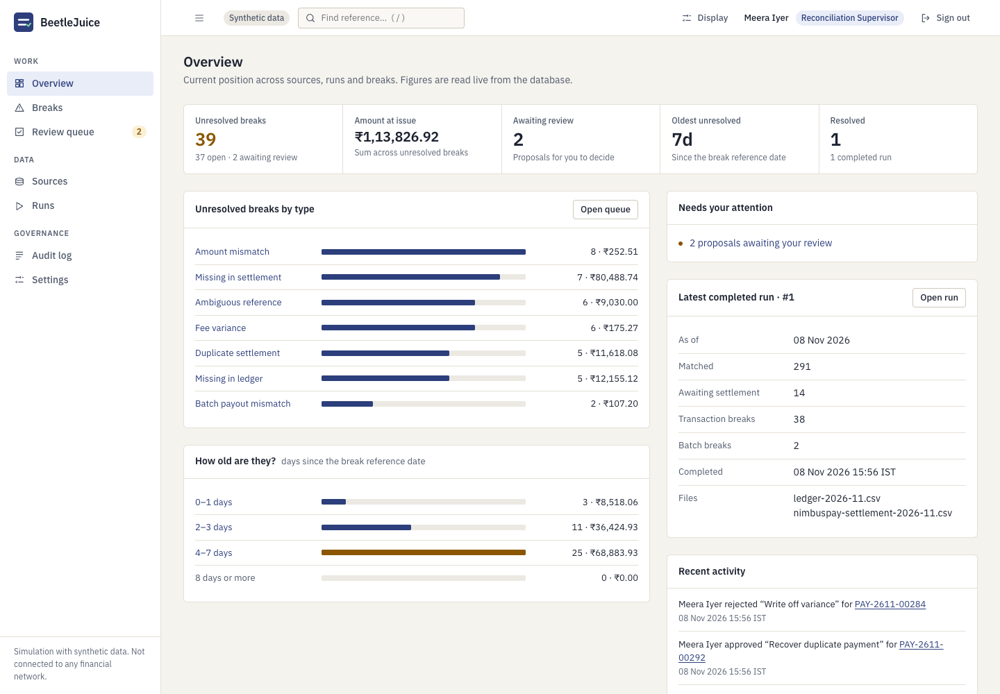
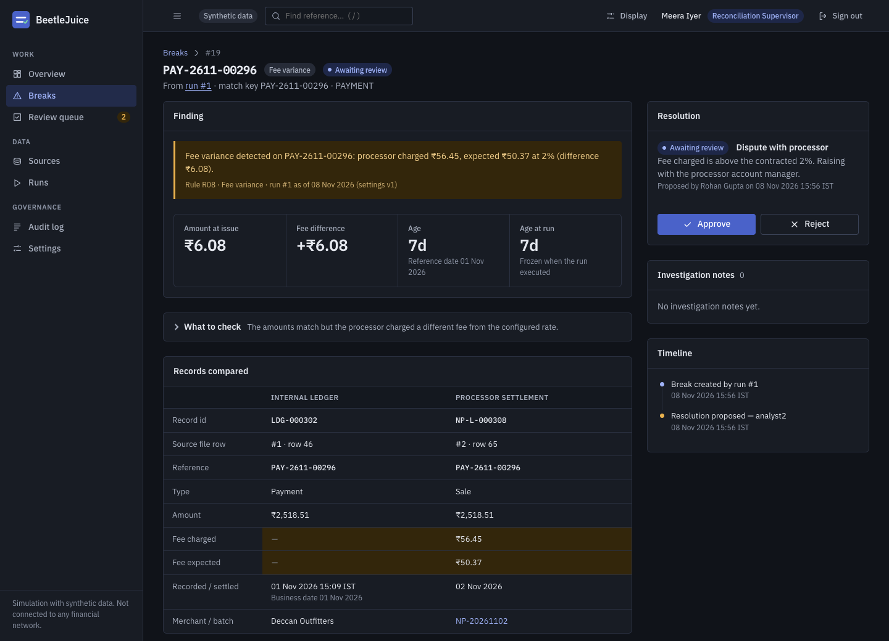
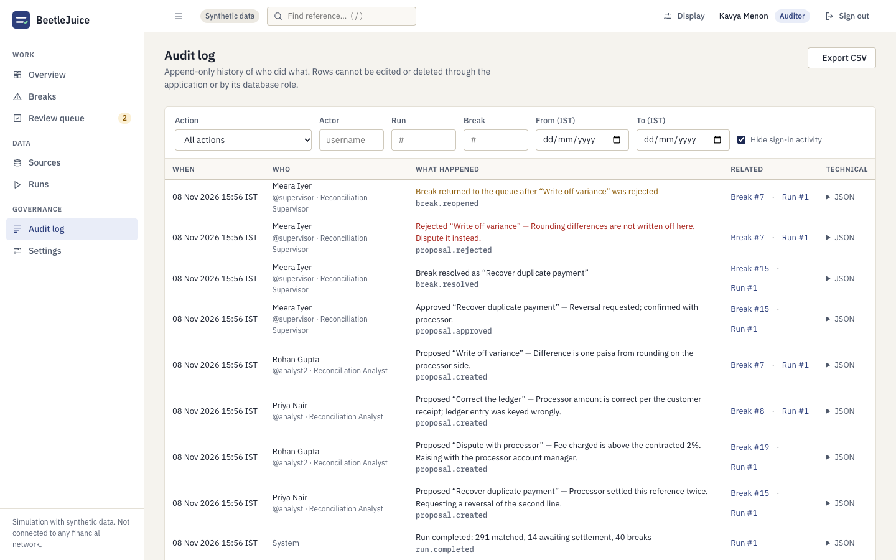
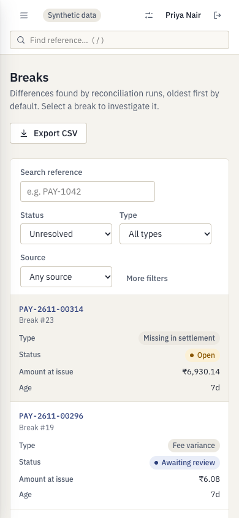
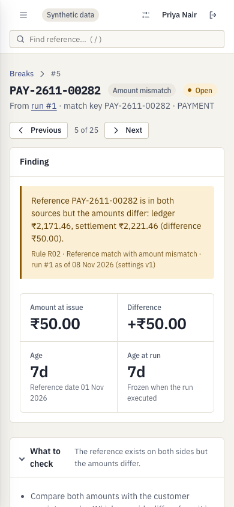

# BeetleJuice

**Settlement reconciliation and break management for payment operations.**

A merchant records payments internally. Its payment processor separately reports what it settled, with fees
and net payouts. The two rarely agree: timing, duplicates, wrong amounts, missing refunds, fee drift, short payouts.
BeetleJuice compares an internal ledger export with a processor settlement export, explains every difference,
and puts the exceptions through a controlled maker-checker resolution workflow with an audit trail.

> This is a simulation that uses **synthetic data only**. It does not connect to any bank, card network or
> payment processor, and it never posts anything to a ledger.


<table>
<tr>
<td width="50%"></td>
<td width="50%"></td>
</tr>
<tr>
<td></td>
<td></td>
</tr>
<tr>
<td></td>
<td></td>
</tr>
</table>

<p>


</p>

All screenshots are captured from the running application with the synthetic demo data (`npm run screenshots`), in Chrome.

## What it does

* **Ingests two CSV exports** with strict validation: header contract, UTF-8, size and row limits, integer-paise
  amounts, explicit UTC offsets on timestamps. Invalid rows are reported (row, field, reason, original content),
  never silently dropped. Identical files are rejected by SHA-256 and a database unique index.
* **Reconciles deterministically** with a documented multi-pass engine: exact match, amount mismatch,
  duplicate settlement, pending within the settlement window, missing on either side, batch payout totals, fee
  variance — plus an **ambiguity guard** so a repeated reference is never paired by guesswork.
  Every record gets exactly one explained outcome. See [reconciliation rules](docs/reconciliation-rules.md).
* **Freezes each run's configuration** (settings version, as-of date, input hashes, engine version), so later
  settings changes never rewrite history.
* **Runs in the background** from a PostgreSQL-backed queue with leases, retries and crash recovery; the UI shows
  queued → running → completed/failed live.
* **Manages breaks**: filterable, sortable, exportable queue with ageing; detail page with both source records,
  rule, explanation, batch context, notes and timeline.
* **Enforces maker-checker**: analysts propose, a *different* supervisor approves or rejects. Concurrent decisions,
  stale views and self-approval are all refused — in the service and again in the database.
* **Keeps an append-only audit history** written in the same transaction as each change.
* **Three roles** (analyst, supervisor, read-only auditor) enforced on the server.
* **Helps an investigation along:** previous/next through the list you came from, per-type "what to check" guidance,
  a *find a reference* search (press `/`) that answers "what happened to PAY-…?" even for payments that matched,
  break ageing on the overview, and an audit log that reads as sentences.
* **Light and dark themes** (follows the OS by default), keyboard-operable, WCAG 2.2 AA checked with axe-core on every screen, and a
  phone layout where tables become labelled cards.

## How a day's reconciliation works

1. **Upload** the merchant's ledger export and the processor's settlement export (Sources). Every row is validated; rejected rows are listed with the reason; the same bytes are never accepted twice.
2. **Run** them against each other as of a business date. Settings (fee rate, tolerances, settlement window) are frozen into the run; a worker processes it in the background and the page shows its real state.
3. **Read the result:** matched, awaiting settlement (not yet a break), breaks by type, and batch payouts that disagree with their lines. Every outcome carries the rule that produced it and a sentence explaining it.
4. **Investigate** a break from the queue: both records side by side, the batch it belongs to, guidance on what to check, notes.
5. **Propose** a resolution (analyst, the *maker*). Nothing changes until step 6.
6. **Decide** (a different supervisor, the *checker*): approve to resolve, or reject with a reason, which reopens the break.
7. **Audit:** every step above is in an append-only log, written in the same transaction as the change it records.

## Quick start

Requirements: Node.js ≥ 20.12 and a local PostgreSQL ≥ 14.

```bash
git clone https://github.com/Ayush-o1/BeetleJuice.git && cd BeetleJuice
npm install
cp .env.example .env                 # adjust DATABASE_URL if your Postgres needs credentials
npm run db:create                    # creates the database named in DATABASE_URL (never drops anything)
npm run migrate
ALLOW_DEMO_RESET=true npm run demo:reset -- --yes --load-sample   # dev only: demo users + sample run
npm run dev                          # http://localhost:3000
```

Sign in with the demo accounts (development only; password `BeetleJuice-Demo-2026`):
`analyst`, `analyst2`, `supervisor`, `supervisor2`, `auditor`.
`demo:reset` **drops the schema** of the target database and refuses to run in production, without
`ALLOW_DEMO_RESET=true`, without `--yes`, or against a database not named `*_dev`, `*_demo` or `*_test`.
For a real deployment create users with `BJ_PASSWORD=… npm run user:create -- <username> <role> "<Name>"`.

Step-by-step demonstration: [docs/demo-guide.md](docs/demo-guide.md). Sample files and their expected outcomes:
[demo-data/](demo-data/expected-outcomes.md).

### Other kinds of day

Ten deterministic scenarios (a clean day, missing settlements, duplicate references, fee variances, late settlements, refund-heavy,
multi-batch, invalid CSV rows, a break storm, a wrong payout) at four sizes (about 20 to 28,000 rows), each with a documented expected outcome:

```bash
npm run demo:scenarios -- --list
ALLOW_DEMO_RESET=true npm run demo:reset -- --yes --scenario break-storm --size normal
```

See [docs/data-scenarios.md](docs/data-scenarios.md).

## Configuration

Read and validated at start-up ([`src/config`](src/config/index.js)); the app refuses to start on invalid values.

| Variable | Default | Purpose |
|---|---|---|
| `DATABASE_URL` | — (required) | PostgreSQL connection string |
| `PORT`, `NODE_ENV`, `LOG_LEVEL` | 3000, development, info | |
| `UPLOAD_DIR` | `./data/uploads` | Where raw CSV bytes are kept (outside `public/`) |
| `MAX_UPLOAD_BYTES`, `MAX_UPLOAD_ROWS` | 10 MiB, 50,000 | Upload limits |
| `SESSION_IDLE_MINUTES`, `SESSION_ABSOLUTE_HOURS` | 30, 8 | Session lifetime |
| `COOKIE_SECURE`, `TRUST_PROXY` | true in production, false | Secure cookies; trust `X-Forwarded-*` |
| `WORKER_IN_PROCESS`, `WORKER_POLL_MS` | true, 1500 | Run the worker inside the web process |
| `RUN_MAX_ATTEMPTS`, `RUN_LEASE_SECONDS` | 3, 120 | Retry limit and lease length |
| `LOGIN_RATE_MAX`, `LOGIN_RATE_WINDOW_MINUTES` | 20, 15 | Per-IP sign-in limiter |
| `SCRYPT_LOG2_N` | 17 | Password hashing cost (≥ 17 enforced in production) |
| `ALLOW_DEMO_RESET` | false | Opt-in for `demo:reset` |

## Commands

| | |
|---|---|
| `npm run dev` / `npm start` | Start the app (`dev` restarts on change) |
| `npm run worker` | Stand-alone worker (use with `WORKER_IN_PROCESS=false`) |
| `npm run migrate` | Apply pending SQL migrations (checksummed, forward-only) |
| `npm run demo:generate` | Regenerate the original November demo files in `demo-data/` (deterministic) |
| `npm run demo:scenarios` | Generate scenario data sets (`-- --list`, `-- --scenario <name> --size <size> --seed <n> --out <dir>`) |
| `npm run bench` | Measure ingest, engine, queries and the HTTP API on 45k-row files (`-- --browser` adds Chrome render timings) |
| `npm run screenshots` | Re-capture the documentation screenshots from the running demo |
| `npm test`, `test:unit`, `test:integration`, `test:e2e`, `lint` | See [docs/testing.md](docs/testing.md) |

## Architecture in brief

One Express monolith, plain SQL on PostgreSQL, a vanilla-JS single-page UI served from the same origin.

```
routes ─► services ─► repositories (SQL) ─► PostgreSQL
              │
              └─► engine (pure function)       worker: claims runs with SKIP LOCKED + lease
```

Details: [architecture](docs/architecture.md) · [domain model](docs/domain-model.md) ·
[rules](docs/reconciliation-rules.md) · [API](docs/api.md) · [security review](docs/security.md) ·
[performance](docs/performance.md) · [decision records](docs/decisions/).

Stack: Node.js, Express 5, `pg`, zod, helmet, pino, csv-parse. No ORM, no front-end framework, no build step, no Redis.

## Key design decisions

* **Integer paise everywhere; fees as exact rationals** with one documented half-up rounding rule.
* **Reference is not a unique key.** Records match on `(reference, direction)` and ambiguous groups become breaks.
* **Pending ≠ missing.** A settlement window and an explicit as-of date decide; results are immutable and a later run re-evaluates.
* **Database-enforced invariants:** one result per record per run, duplicate-file and duplicate-run protection,
  single pending/approved proposal per break, maker-checker and status-transition triggers, append-only history.
* **Server-side sessions + CSRF token**, scrypt passwords, strict CSP, permission matrix enforced per route.

## Testing

`npm test` runs **218 tests, all passing at v1.1.0 with none skipped** (Chrome installed): 113 unit, 74 integration against real PostgreSQL, 31 in Chrome (verified by three consecutive full runs on macOS, and by CI).

* **Unit:** engine rules and precedence, money and exact fee rounding, dates, CSV parsing, permissions, plus the whole **scenario library**: every scenario at several sizes is run through the real parsers and engine and must reproduce an expectation that was *constructed*, not computed (see [data-scenarios.md](docs/data-scenarios.md)), and engine invariants are checked on that data (one result per record, no silent amount match, order independence).
* **Integration:** concurrent uploads, runs and reviewer decisions, worker crash recovery, database constraints with the service layer bypassed, every scenario end to end over HTTP, and migrations on an empty database.
* **Browser:** the analyst → supervisor → auditor journey, workflows (filters, pagination, queue navigation, search, theme, uploads and their failures, role limits, outage and session expiry), and **accessibility**: axe-core on every screen in both themes on desktop and phone plus keyboard, reduced-motion, reflow and target-size checks.

Run `npm test`; details in [docs/testing.md](docs/testing.md). Performance numbers (and how they were measured) are in [docs/performance.md](docs/performance.md).

## Documentation

| | |
|---|---|
| [docs/architecture.md](docs/architecture.md) · [domain-model.md](docs/domain-model.md) · [reconciliation-rules.md](docs/reconciliation-rules.md) | How it is built, what the data means, how matching decides |
| [docs/api.md](docs/api.md) · [security.md](docs/security.md) | HTTP API; threat model and what is and is not protected |
| [docs/testing.md](docs/testing.md) · [data-scenarios.md](docs/data-scenarios.md) · [performance.md](docs/performance.md) | What each test layer proves; the data sets; measured numbers and how |
| [docs/demo-guide.md](docs/demo-guide.md) · [troubleshooting.md](docs/troubleshooting.md) | A ten-minute walkthrough; fixing the usual problems |
| [docs/decisions/](docs/decisions/) | Architecture decision records (0001–0015) |
| [docs/refinement/](docs/refinement/audit.md) | The v1.1.0 product audit, research notes and what was deliberately not done |
| [CHANGELOG.md](CHANGELOG.md) · [CONTRIBUTING.md](CONTRIBUTING.md) | Release history; how to contribute |

## Limitations (stated plainly)

* Simulation only: resolutions record a decision; nothing is posted anywhere.
* One ledger file and one settlement file per run; no merchant-specific fee rates; calendar days, no holiday calendar.
* No fuzzy matching: a mistyped reference becomes two breaks. Breaks are not carried across runs.
* The audit log is append-only by application and trigger, **not tamper-proof** (the table owner can drop triggers).
* No MFA, password reset or user-management UI; in-memory login limiter (single process); uploads are not virus-scanned.
* Visual quality was reviewed by hand in Chrome; there are no screenshot-diff tests. Accessibility is checked with axe-core, keyboard tests and structure, **not** with a screen reader; Safari and Firefox were not tested.
* Break previous/next covers the current page of results (25), not the whole queue. The "what to check" guidance is static text, not a recommendation engine.

## Project status

Feature-complete for its scope: **v1.1.0** (v1.0.0 plus the refinement described in [CHANGELOG.md](CHANGELOG.md)). See [docs/project-plan.md](docs/project-plan.md) for how it was built and
verified, and [CONTRIBUTING.md](CONTRIBUTING.md) to work on it. Licensed under the [MIT License](LICENSE).
Fonts: IBM Plex (SIL Open Font License, bundled in `public/fonts`).
