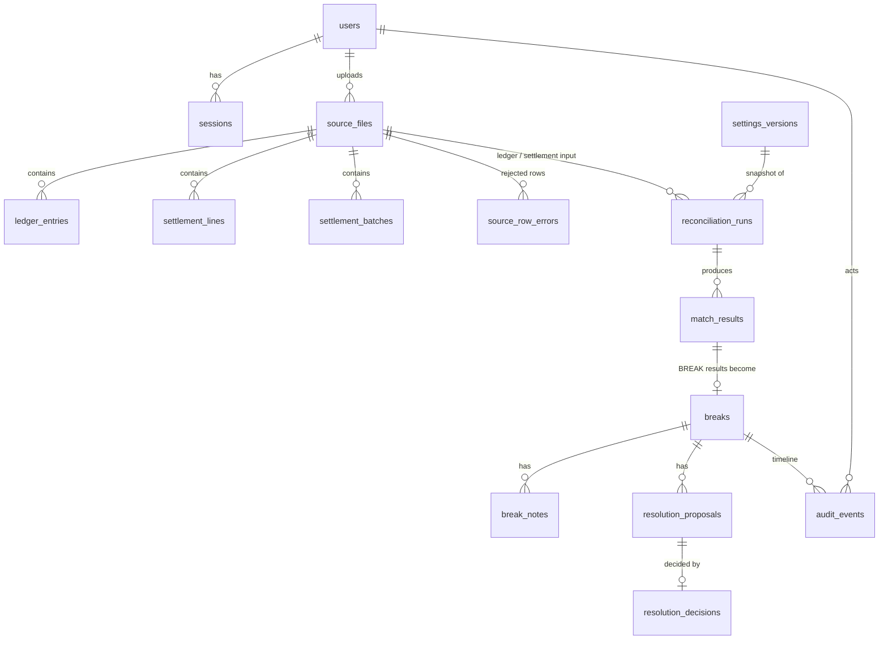

# Domain model

## Glossary

| Term | Meaning here |
|---|---|
| **Ledger entry** | A payment or refund the merchant recorded internally (`ledger_entries`). |
| **Settlement line** | One transaction the processor reports as settled (`settlement_lines`, `TXN` rows). |
| **Batch** | A processor payout covering many lines, with declared gross, fee and payout totals (`settlement_batches`, `BATCH` rows). |
| **Gross / fee / net / payout** | Gross = signed sum of line amounts; fee = fees the processor charged on those lines; net (expected payout) = gross − fees; payout = what the processor *declares* it paid. |
| **Match key** | `(normalised reference, direction)` where direction is payment or refund. |
| **Settlement window** | Calendar days after the recorded business date during which an unsettled entry is *pending*, not a break. |
| **As-of date** | The business date a run is judged against. Part of the run configuration, never the wall clock. |
| **Break** | A work item raised for a result that needs a human: wrong amount, missing record, duplicate, fee or payout difference, ambiguity. |
| **Maker / checker** | Analyst proposes a resolution; a different user (supervisor) approves or rejects it. |

## Entities



* **Immutable after insert** (trigger-enforced): `source_files`, `ledger_entries`, `settlement_*`,
  `source_row_errors`, `settings_versions`, `match_results`, `break_notes`, `resolution_decisions`, `audit_events`.
* **Mutable by rule:** `reconciliation_runs` (status/lease/summary only), `breaks` (status, version, resolution),
  `resolution_proposals` (only `pending → approved|rejected`), `users` (login counters), `sessions`.
* Foreign keys are `RESTRICT` (default); nothing in the business model is deleted. `sessions` cascade with their user.

## Status models

```
run:       queued ──► running ──► completed
              ▲          │ └────► failed            (terminal: completed, failed)
              └──────────┘  retry while attempts < max_attempts, or lease expired

break:     open ──► pending_review ──► resolved     (terminal)
              ▲            │
              └────────────┘  proposal rejected → open again

proposal:  pending ──► approved | rejected          (terminal)

result (per record, per run): MATCHED | PENDING | BREAK(type)
```

A *pending* item is not a status that changes in place. Results are immutable; the next run (later as-of date
or a newer settlement file) evaluates the same ledger entry afresh and it becomes matched or a
`MISSING_IN_SETTLEMENT` break. See [demo guide](demo-guide.md) for how to show this.

## Financial invariants

| Invariant | Enforced by |
|---|---|
| Amounts are integer paise, non-zero, ≤ ±₹1 crore per line | `bigint` columns + `CHECK`, parser, `Number.isSafeInteger` guards |
| Payments positive, refunds negative (ledger converts, processor must already be signed) | `CHECK` on both tables; row validators |
| Only INR | `CHECK (currency = 'INR')` |
| A file's bytes are stored once per kind | `UNIQUE (kind, content_sha256)` |
| Within a file, ids are unique (`ledger_id`, `line_id`, `batch_id`) | `UNIQUE` + row validators |
| One result per record per run (true one-to-one) | partial unique indexes on `match_results` |
| An identical run cannot be queued twice | partial unique index on `input_fingerprint WHERE status <> 'failed'` |
| One open proposal and one approved proposal per break at most | partial unique indexes on `resolution_proposals` |
| A decision is by a supervisor who is not the proposer | trigger on `resolution_decisions` (and the service) |
| Illegal status transitions are impossible | triggers on runs, breaks, proposals |
| History cannot be rewritten through SQL by the application | `forbid_mutation()` triggers (see [security](security.md) for limits) |

## Refund and sign conventions

* **Ledger file:** `amount` is a positive magnitude; `entry_type` says `PAYMENT` or `REFUND`. Stored signed
  (refund negative).
* **Processor file:** `amount` is already signed and `txn_type` must agree (`SALE` > 0, `REFUND` < 0); a
  disagreement rejects the row. Fees are non-negative and never exceed the amount.
* A refund and a payment sharing a reference are different match keys and never pair with each other.
* Expected fee on a refund is ₹0 in this model; a non-zero fee on a refund line is a fee variance.
